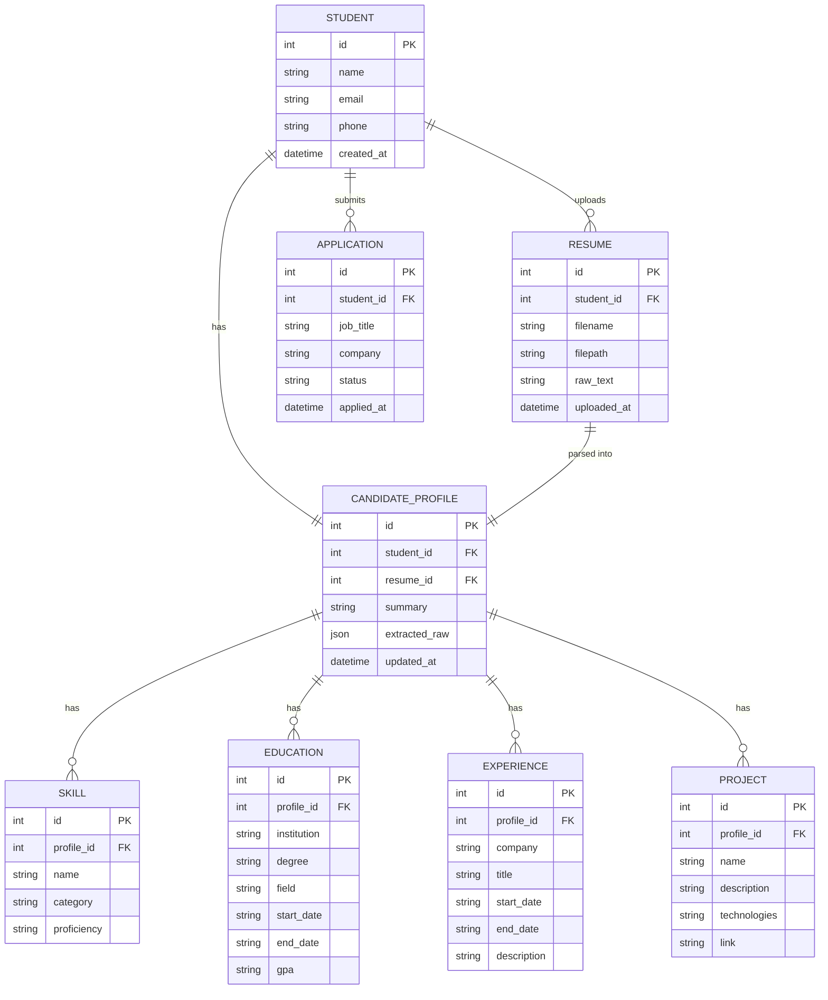

# M1.2 — System Architecture

## 1. High-Level Architecture Diagram

```mermaid
flowchart TB
    subgraph Client["Student / User Interface"]
        UI[Profile & Resume Upload UI]
    end

    subgraph API["Backend / API Layer (FastAPI)"]
        EP1[Student/Profile Endpoints]
        EP2[Resume Upload Endpoint]
        EP3[Agent/Orchestrator Endpoints]
        EP4[Application Tracking Endpoints]
    end

    subgraph Storage["Resume Upload / Storage"]
        FS[(File Storage<br/>local disk / S3)]
    end

    subgraph ParsingLayer["Resume Parsing Module"]
        TXT[Text Extraction<br/>pdfplumber / python-docx]
        LLMX[LLM Structured Extraction<br/>skills, education, experience, projects]
    end

    subgraph DB["Database (PostgreSQL / SQLite)"]
        StudentT[(Student)]
        ResumeT[(Resume metadata)]
        ProfileT[(Candidate Profile)]
        SkillT[(Skills)]
        EduT[(Education)]
        ExpT[(Experience)]
        ProjT[(Projects)]
        AppT[(Applications / Tracking)]
    end

    subgraph KB["Job-Posting Knowledge Base"]
        JobDocs[(Job postings / JDs)]
        VecStore[(Vector Store<br/>Chroma / pgvector)]
    end

    subgraph RAG["RAG Pipeline"]
        Embed[Embedding model]
        Retrieve[Retriever / Re-ranker]
        Augment[Prompt Augmentation]
    end

    subgraph Agents["AI Agent Layer"]
        Orchestrator{{Career Assistant<br/>(Orchestrator)}}
        A1[Resume Agent]
        A2[Job-Resume Matching Agent]
        A3[Skill Gap Agent]
        A4[Cover Letter Agent]
        A5[Interview Agent]
    end

    LLM[(Claude LLM<br/>Anthropic API)]

    UI -->|1. create profile| EP1 --> StudentT
    UI -->|2. upload resume| EP2 --> FS
    EP2 --> ResumeT
    EP2 --> TXT --> LLMX
    LLMX --> LLM
    LLMX -->|structured JSON| ProfileT
    LLMX --> SkillT & EduT & ExpT & ProjT

    UI -->|3. ask for match / gap / cover letter / interview prep| EP3 --> Orchestrator
    Orchestrator --> A1 & A2 & A3 & A4 & A5
    A1 --> ProfileT
    A2 --> ProfileT
    A2 --> RAG
    A3 --> ProfileT
    A3 --> RAG
    A4 --> ProfileT
    A4 --> RAG
    A5 --> ProfileT
    RAG --> Embed --> VecStore
    JobDocs --> Embed
    RAG --> Retrieve --> VecStore
    Retrieve --> Augment --> LLM
    A2 & A3 & A4 & A5 --> LLM

    UI -->|4. track applications| EP4 --> AppT
```

*(Renders natively on GitHub. A static PNG export can be added under `docs/architecture.png`
once finalized.)*

## 2. Component Responsibilities

| Component | Responsibility | Status |
|---|---|---|
| Student/User Interface | Profile creation form, resume upload, (later) job browsing, application tracking dashboard | **M1: built (basic HTML/JS)** |
| Backend/API Layer | FastAPI app exposing REST endpoints; validates input, coordinates storage + parsing + agents | **M1: built** |
| Resume Upload/Storage | Accepts PDF/DOCX, stores file on disk (swap-in S3 later), records metadata | **M1: built** |
| Resume Parsing Module | Extracts raw text, then calls LLM to produce structured JSON (skills/education/experience/projects) | **M1: built** |
| Candidate Profile | Normalized structured record derived from resume + manual edits; single source of truth for all downstream agents | **M1: built** |
| Database | Persists Student, Resume metadata, Candidate Profile, Skills, Education, Experience, Projects, (future) Applications | **M1: built (SQLite, SQLAlchemy)** |
| Job-Posting Knowledge Base | Store of scraped/ingested job descriptions, to be embedded for retrieval | Planned — M2 |
| RAG Pipeline | Embeds job postings + candidate profile, retrieves relevant postings/requirements for matching, gap analysis, cover letters | Planned — M2 |
| AI Agent Layer | Orchestrator + 5 specialist agents (below) | Resume Agent (parsing) built in M1; others planned |
| Application Tracking Module | Tracks applied/shortlisted/interview/offer/rejected status per job per student | Planned — M3 |

## 3. Agent Roles

| Agent | Responsibility | Inputs | Outputs |
|---|---|---|---|
| **Career Assistant** (orchestrator) | Understands the student's intent/request and routes it to the right specialist agent; maintains conversation context | Student message/intent | Routed action + aggregated response |
| **Resume Agent** | Parses uploaded resumes into structured data; keeps Candidate Profile up to date | Raw resume text | Structured JSON (skills, education, experience, projects) |
| **Job-Resume Matching Agent** | Computes/explains match between a Candidate Profile and a job posting using RAG over the Job-Posting Knowledge Base | Candidate Profile, Job posting(s) | Match score + explanation |
| **Skill Gap Agent** | Identifies missing/weak skills relative to a target role or posting, suggests resources | Candidate Profile, Job posting(s) | Gap list + learning suggestions |
| **Cover Letter Agent** | Generates a tailored cover letter grounded in the Candidate Profile and the specific job posting | Candidate Profile, Job posting | Draft cover letter |
| **Interview Agent** | Generates likely interview questions and mock feedback based on role + profile | Candidate Profile, Job posting | Practice Q&A / feedback |

## 4. Candidate Profile Data Model



## 5. Data Flow: Resume Upload → Parsing → Structured Profile

1. Student creates a profile (`POST /students`) → row in `Student`.
2. Student uploads a resume file (`POST /students/{id}/resume`) → file saved to
   `Resume Upload/Storage`, metadata + raw bytes path saved to `Resume` table.
3. Parsing is triggered (`POST /students/{id}/resume/{resume_id}/parse`, or automatically
   right after upload):
   a. `Resume Parsing Module` extracts raw text (`pdfplumber` for PDF, `python-docx` for DOCX).
   b. Raw text is sent to the LLM (`llm_extractor.py`) with a strict JSON-schema prompt.
   c. LLM returns structured JSON: `skills`, `education`, `experience`, `projects`, `summary`.
   d. Backend validates/normalizes the JSON (Pydantic) and upserts it into `CandidateProfile`,
      `Skill`, `Education`, `Experience`, `Project` tables.
4. `GET /students/{id}/profile` returns the full structured Candidate Profile — this is the
   object every future agent (Matching, Skill Gap, Cover Letter, Interview) will consume.

## 6. Why this architecture

- **Separation of concerns**: parsing (deterministic-ish, LLM-assisted) is decoupled from
  generation (Matching/Cover Letter/Interview agents), so M1 can be fully built and tested
  without needing the RAG/job-postings pieces from later milestones.
- **Single structured source of truth** (Candidate Profile) means every later agent reads/writes
  the same schema instead of re-parsing free text — reduces hallucination and makes outputs
  auditable/debuggable.
- **Orchestrator pattern** keeps the door open to add new agents later (e.g. a Networking Agent)
  without restructuring the whole system.
